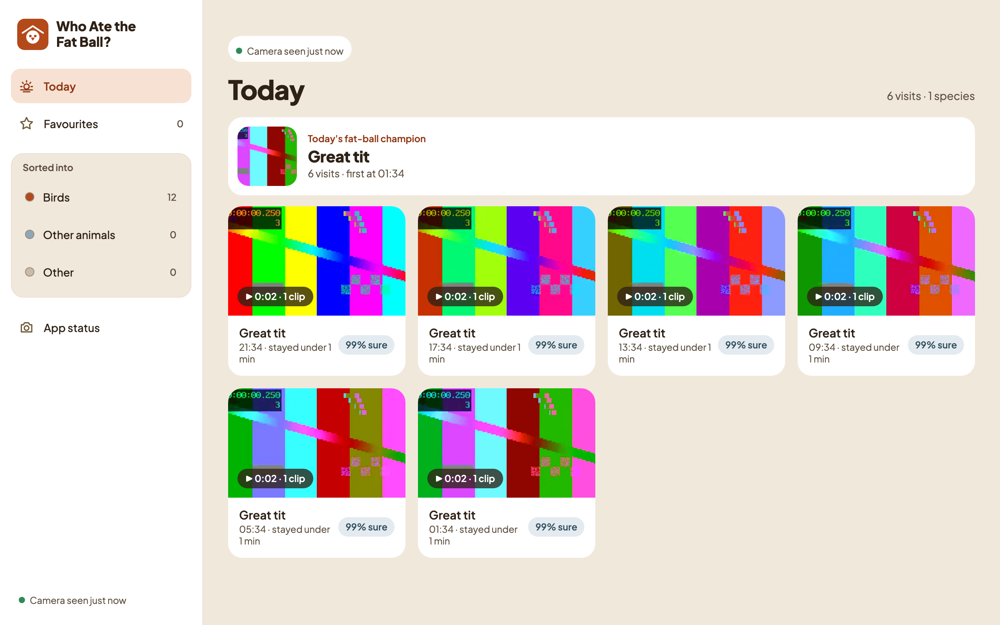
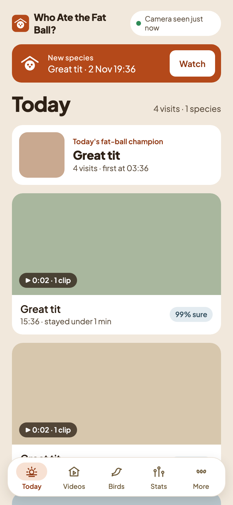
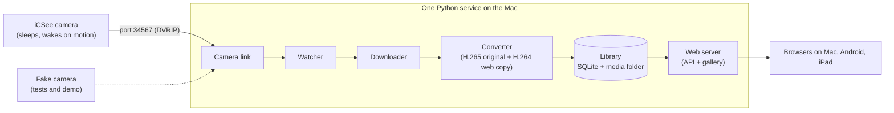

# Who Ate the Fat Ball? 🐦

[](https://github.com/ksycz/who-ate-the-fat-ball/actions/workflows/ci.yml)
[](LICENSE)

A free, local app for bird-feeder cameras: it collects the clips for you and tells you who has been visiting. No ads, no cloud, no false alarms.

> **Status: phase 1, gallery part 1.** Clip ingest, bird recognition and a gallery you can open on your phone, iPad or Mac work today. Videos, Stats and bulk tools come in Plan 4.

| Mac | Phone |
|---|---|
|  |  |

<sub>Screenshots from demo mode, with generated test-pattern clips.</sub>

## The problem

Cheap outdoor Wi-Fi cameras (iCSee, XMEye and other Xiongmai-based models) are great for a bird feeder, but their phone apps are full of ads, send alerts for wind and shadows, don't know which bird is on the feeder, and make it hard to find the clips you care about. Battery models also sleep between visits, so most tools can't reach them.

## What works today

- **Automatic ingest** from a sleeping iCSee/Xiongmai camera over its local DVRIP protocol (port 34567). A watcher notices when the camera wakes up, then downloads the new clips from its memory card.
- **Conversion to web video**: the original H.265 file is kept, and an H.264 MP4 copy plays in any browser.
- **A library** (SQLite plus a media folder) of every clip.
- **A JSON API** on your home network: status, clips and media with range requests. Anyone on the network can view; changing data needs the edit PIN (or a request from the Mac itself).
- **Demo mode** with a fake camera and generated clips, so you can try it without any hardware.
- **Bird recognition on your own Mac**:
  - A detector finds the animals and people in each new clip. Each animal is then matched against examples you labelled yourself.
  - The species is named only when the match is clear; otherwise the clip is "Unknown bird". Dogs and people go to Other.
  - Clips less than a minute apart with the same visitor are grouped into a visit.
  - You can correct a visit through the API, and the correction teaches the matcher straight away. Undo takes it back.
  - On the owner's 63 hand-labelled clips, it put 59 in the right section and named 13 of 17 clear birds.
  - It takes about 1 s per clip, under 300 MB of memory, at low priority.
  - On the real camera, new clips were recognised a median of 13 s after download.
- **A gallery on your phone, iPad and Mac** at `http://<your Mac's name>.local:8080`:
  - **Today**: the day's visits, the fat-ball champion, a banner for a new species and the camera's status.
  - **Birds, Other animals, Other and Favourites**: every visit, grouped by day.
  - **A visit**: play its clips, mark it as a favourite, download it, and fix a wrong name with "What is it?" (with Undo).
  - Phones and iPads can look; changing anything needs the edit PIN (**More → Unlock editing**).
  - It can be added to the home screen, and works on a phone, an iPad and a big screen.

## What's coming

- **Plan 4: the gallery, part 2.** Videos, By species, selecting and moving many visits, zip downloads, drag-and-drop on the Mac, Stats with a heatmap and a Mac notification for a new species.

## Try the demo

```sh
brew install ffmpeg uv node
uv sync
npm --prefix web ci && npm --prefix web run build   # build the gallery once
uv run fatball demo
```

Then open <http://localhost:8080>. The demo uses a pretend camera and generated test clips, and keeps nothing afterwards.

## Use it with your camera

```sh
uv run fatball setup    # on the Mac: camera password, edit PIN, optional camera IP
uv run fatball serve    # watcher, converter and web app in one process
scripts/install-launchagent.sh   # optional: start at login and restart after a crash
```

The setup page is only available at <http://localhost:8080> on the Mac itself. Run `uv run fatball --help` for all options.

**Opening the gallery on a phone or iPad:** use `http://<your Mac's name>.local:8080` on the same Wi-Fi (on Android, the Mac's IP address also works, e.g. `http://192.168.1.20:8080`). If an Android phone says a local-network permission is missing, allow it under **Settings → Apps → Chrome → Permissions → Nearby devices**. On an iPhone or iPad, a browser other than Safari needs **Settings → Privacy & Security → Local Network**.

**If the app says "camera not found" while the camera is awake:** macOS may be blocking the program from your home network. Run `fatball serve` from the Terminal app and click **Allow** when macOS asks about finding devices on the local network, or turn on the app you run it from under **System Settings → Privacy & Security → Local Network**.

**If the camera's password keeps changing:** iCSee can replace an empty camera password with a hidden random one, after which the app gets "wrong password". While the camera still accepts the saved password (for example straight after "Restore defaults"), give it one you choose:

```sh
uv run fatball set-camera-password
```

It changes the camera's password, checks that the new one works, then saves it in the Keychain. iCSee keeps working, because it doesn't use this login.

## Architecture



The camera link is the only code that speaks the Xiongmai protocol, and the library is the only code that touches SQLite and media files. The bird spotter sits between the converter and the library, and the same process serves the gallery (Svelte, built into `src/fatball/api/static/`). See the [design spec](docs/superpowers/specs/2026-10-31-who-ate-the-fat-ball-design.md) for the full picture.

## Privacy and security

- Everything stays on your home network. There is no account, no cloud and no subscription.
- The camera password is stored only in the macOS Keychain, never in the database, files or logs.
- The edit PIN is stored as a salted hash. Viewing needs no login; changing data needs the PIN or a request from the Mac itself.
- Real footage and camera identifiers are never committed. Test video is generated with ffmpeg.

## Bird recognition model

The bird spotter runs MegaDetector v6 (MIT, yolov9-c) through Core ML, so the app needs no PyTorch. The model file is about 20 MB and is not committed; build it once in a throwaway environment (any Python 3.12 environment with torch, coremltools and PytorchWildlife works):

```sh
uv run --python 3.12 --with torch --with coremltools --with PytorchWildlife scripts/export_detector.py "$HOME/Library/Application Support/WhoAteTheFatBall/models"
```

PytorchWildlife itself is MIT, but it depends on ultralytics and yolov5, which are AGPL, so only this export script uses it. Nothing under `src/` imports any of them. Set `FATBALL_DETECTOR` to the `.mlpackage` path to run the real-model test.

### Turning recognition on: export, import, then serve

Do these in order the first time:

1. **Export the model** with the command above.
2. **Import labelled examples** from a CSV with the columns `clip_id,label`, where a label is a species (English or scientific name), `dog`, `nothing`, `person` or `skip`:

   ```sh
   uv run fatball examples-import labels.csv
   ```

   Clips in the CSV that haven't been recognised yet are recognised first and put into visits. If one of them fails, nothing is labelled and the command tells you which clip it was.
3. **Serve** with `uv run fatball serve`. New clips are recognised as they arrive; older ones stay plain videos until you ask.

Recognition waits while there are no examples at all. Clips still convert and play, they just stay "pending" (`/api/status` shows `recognition.examples`). Without that wait, every clip would be filed as an unknown bird and never looked at again. Correcting a visit (`PATCH /api/visits/{id}`) also adds examples.

### Older clips: only when you ask

Only new clips are recognised by default; `/api/status` shows `recognition.old_waiting` for the older ones. Recognise some now with `uv run fatball recognize-old --limit 20` (add `--newest-first` to start from the latest; Ctrl-C stops after the current clip), or let the app work through all of them slowly in the background with `uv run fatball recognize-old --background on` (`off` turns it back off). Retrying a clip always recognises it.

A Mac banner announces new bird visits (and new species) while `fatball serve` runs; `uv run fatball notifications off` silences it (`on` turns it back on, no argument shows the state).

### Your library is backed up before an upgrade

Before the app upgrades an existing library to a newer format, it saves a copy next to it, for example `library.sqlite.v1.bak` in `~/Library/Application Support/WhoAteTheFatBall/`. Upgrades can't be undone, so keep that file until you're happy with the new version. An existing backup is never overwritten.

## Design process

The project started from a written [design spec](docs/superpowers/specs/2026-10-31-who-ate-the-fat-ball-design.md), and each phase has an implementation plan in [docs/superpowers/plans/](docs/superpowers/plans/). The design prototypes and critiques informed the gallery; [Plan 3 results](docs/plan-3-results.md) has the device trial and more screenshots.

## Development

```sh
uv run pytest
uv run ruff check
npm --prefix web test        # gallery unit tests
npm --prefix web run check   # gallery type check
npm --prefix web run dev     # gallery with live reload, talking to a running fatball on :8080
```

End-to-end tests (Playwright, with axe accessibility checks) run against generated test libraries: `cd web && npx playwright test --project=chromium`. CI also runs them in WebKit at iPad size and in Chrome at phone size.

- `src/fatball/camera/`: DVRIP protocol, client, discovery, fake camera
- `src/fatball/ingest/`: watcher and processor
- `src/fatball/media/`: demuxing and ffmpeg conversion
- `src/fatball/library/`: SQLite schema and repository
- `src/fatball/recognition/`: the Core ML bird detector
- `src/fatball/api/`: FastAPI app and edit-PIN auth
- `web/`: the gallery (Svelte 5, TypeScript, Vite), built into `src/fatball/api/static/`
- `tests/`: unit and integration tests, using the fake camera

## Licence

[MIT](LICENSE)
