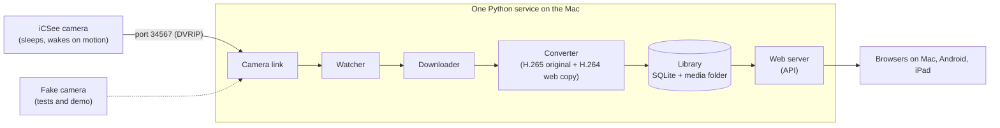

# Who Ate the Fat Ball? 🐦

[](https://github.com/ksycz/who-ate-the-fat-ball/actions/workflows/ci.yml)
[](LICENSE)

A free, local app for bird-feeder cameras: it collects the clips for you and (soon) tells you who has been visiting. No ads, no cloud, no false alarms.

> **Status: phase 1, the foundation.** Clip ingest, conversion, the library and the API work today. Bird recognition and the gallery are not built yet.

## The problem

Cheap outdoor Wi-Fi cameras (iCSee, XMEye and other Xiongmai-based models) are great for a bird feeder, but their phone apps are full of ads, send alerts for wind and shadows, don't know which bird is on the feeder, and make it hard to find the clips you care about. Battery models also sleep between visits, so most tools can't reach them.

## What works today

- **Automatic ingest** from a sleeping iCSee/Xiongmai camera over its local DVRIP protocol (port 34567). A watcher notices when the camera wakes up, then downloads the new clips from its memory card.
- **Conversion to web video**: the original H.265 file is kept, and an H.264 MP4 copy plays in any browser.
- **A library** (SQLite plus a media folder) of every clip.
- **A JSON API** on your home network: status, clips and media with range requests. Anyone on the network can view; changing data needs the edit PIN (or a request from the Mac itself).
- **Demo mode** with a fake camera and generated clips, so you can try it without any hardware.

## What's coming

- **Plan 2: bird recognition.** Spot birds, name the species on your own computer, group clips into visits.
- **Plan 3: the gallery.** A web app (installable on a phone or iPad) built from the prototypes in the design process.

## Try the demo

```sh
brew install ffmpeg uv
uv sync
uv run fatball demo
```

Then open <http://localhost:8080/api/status> and <http://localhost:8080/api/clips>. The gallery UI comes in Plan 3, so for now you get the API.

## Use it with your camera

```sh
uv run fatball setup    # on the Mac: camera password, edit PIN, optional camera IP
uv run fatball serve    # watcher, converter and web app in one process
scripts/install-launchagent.sh   # optional: start at login and restart after a crash
```

The setup page is only available at <http://localhost:8080> on the Mac itself. Run `uv run fatball --help` for all options.

## Architecture



The camera link is the only code that speaks the Xiongmai protocol, and the library is the only code that touches SQLite and media files. Later phases add a bird spotter between the converter and the library, and a gallery served by the same process. See the [design spec](docs/superpowers/specs/2026-10-31-who-ate-the-fat-ball-design.md) for the full picture.

## Privacy and security

- Everything stays on your home network. There is no account, no cloud and no subscription.
- The camera password is stored only in the macOS Keychain, never in the database, files or logs.
- The edit PIN is stored as a salted hash. Viewing needs no login; changing data needs the PIN or a request from the Mac itself.
- Real footage and camera identifiers are never committed. Test video is generated with ffmpeg.

## Design process

The project started from a written [design spec](docs/superpowers/specs/2026-10-31-who-ate-the-fat-ball-design.md), and each phase has an implementation plan in [docs/superpowers/plans/](docs/superpowers/plans/). The design prototypes and critiques (coming to this repo) informed the gallery. Screenshots will be added with the gallery in Plan 3.

## Development

```sh
uv run pytest
uv run ruff check
```

- `src/fatball/camera/`: DVRIP protocol, client, discovery, fake camera
- `src/fatball/ingest/`: watcher and processor
- `src/fatball/media/`: demuxing and ffmpeg conversion
- `src/fatball/library/`: SQLite schema and repository
- `src/fatball/api/`: FastAPI app and edit-PIN auth
- `tests/`: unit and integration tests, using the fake camera

## Licence

[MIT](LICENSE)
