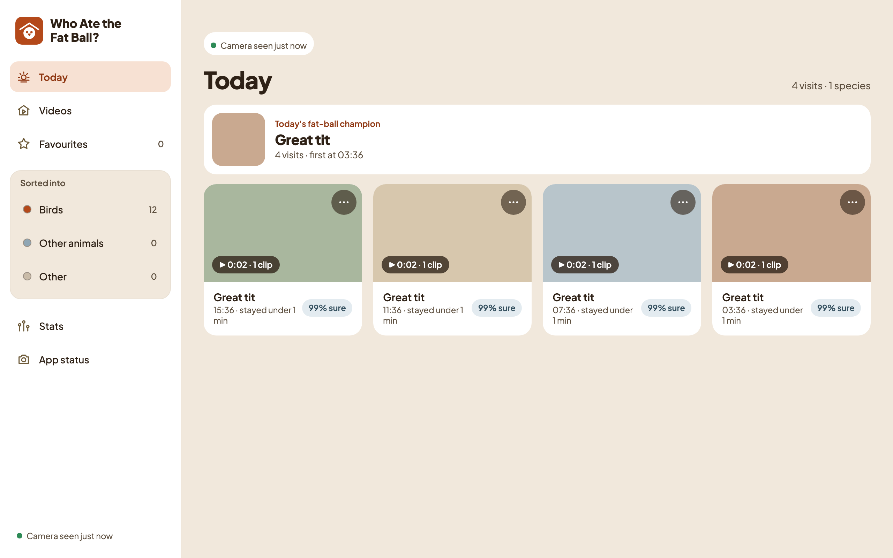
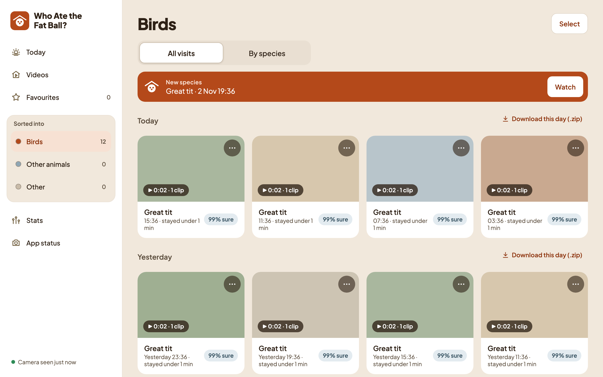
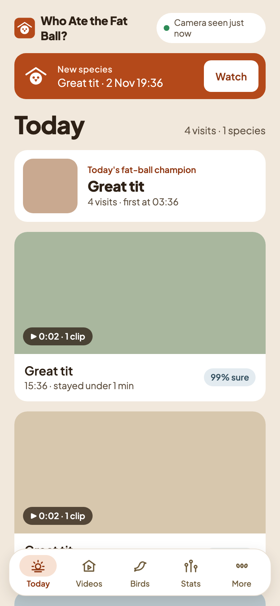
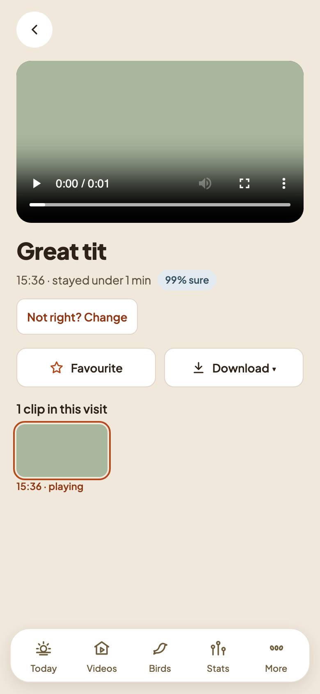

# Plan 3 results: the gallery, part 1

Tried on 2 November 2026 with the real app (`uv run fatball serve`, started from Terminal.app) on the owner's home Wi-Fi.

## What the owner checked

| Device | Browser | Result |
|---|---|---|
| MacBook Air | Safari / Chrome at `http://localhost:8080` | Works. The first try showed the cards one per row; fixed the same day (see below). |
| Google Pixel 9a | Chrome at `http://<Mac name>.local:8080` | Works: Today, playing a clip, Unlock with the PIN, Change and Undo, Back keeping your place in Birds, Add to Home screen. |
| iPad | Safari | Not checked yet. |

Load time was not measured with a stopwatch; the owner found it quick on the phone.

## What we learned

- **Android asks for "Nearby devices".** Chrome on the Pixel needs Android's local-network permission before it can reach the Mac: **Settings → Apps → Chrome → Permissions → Nearby devices → Allow**. If Chrome itself asks, tap **Allow**.
- **Big screens need a grid.** On the Mac, Today and the lists showed one card per row, like a phone. They now use a grid (about four cards per row on a laptop), as in the Mac prototype.
- **Add to Home screen over plain http** gives a shortcut on Android rather than a full app install; that's fine for a home-network app.

## Tests

- Python: `uv run pytest` and `uv run ruff check` pass.
- Gallery: 108 Vitest tests, `svelte-check` with no errors, and 22 Playwright tests in Chromium, including an axe accessibility check.
- The Playwright tests for iPad Safari (WebKit) and Android Chrome run only in CI and have not run yet; they run on the first push.

## Left for Plan 4

Videos, By species, select and bulk move, zip downloads, Mac drag-and-drop, Other filters, deleting empty clips, Stats and the heatmap, screenshot tests and the Mac notifier, plus small leftovers from the reviews (for example, a 403 inside the "What is it?" picker keeps the edit buttons until reload).

## Screenshots

From demo mode (`uv run fatball demo`), with plain-colour placeholder clips, never real footage.

| Mac: Today | Mac: Birds |
|---|---|
|  |  |

| Phone: Today | Phone: a visit |
|---|---|
|  |  |
