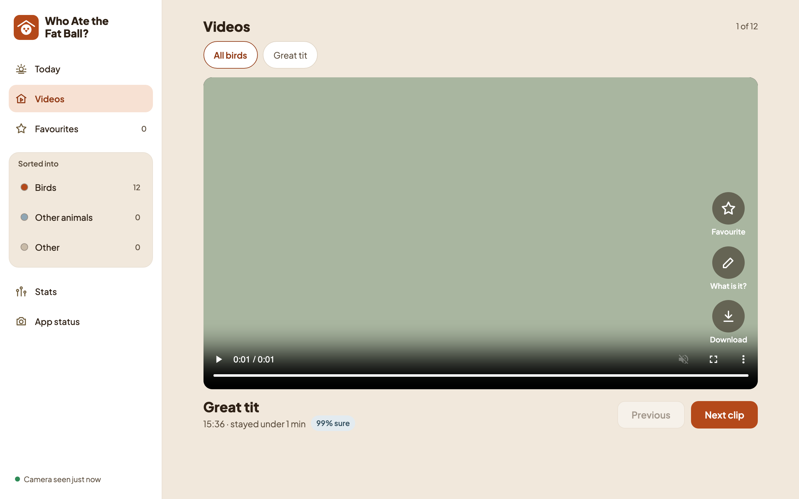
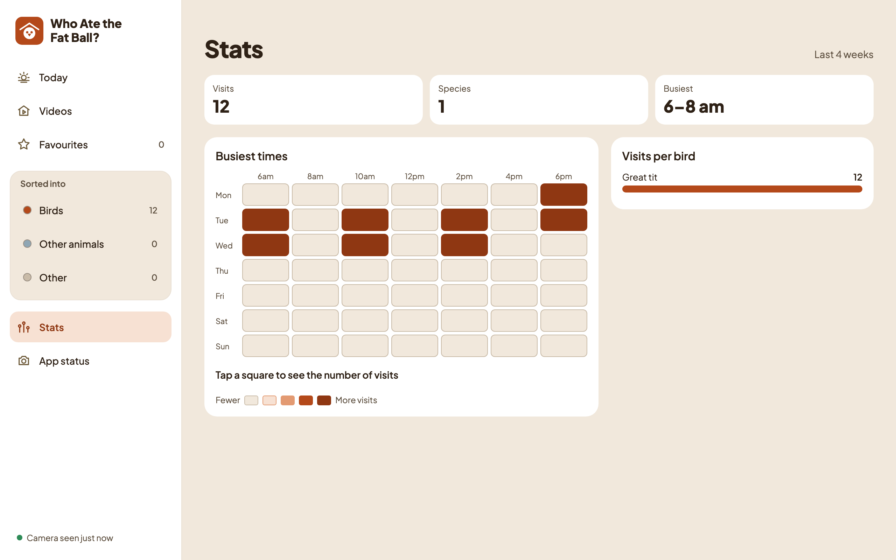
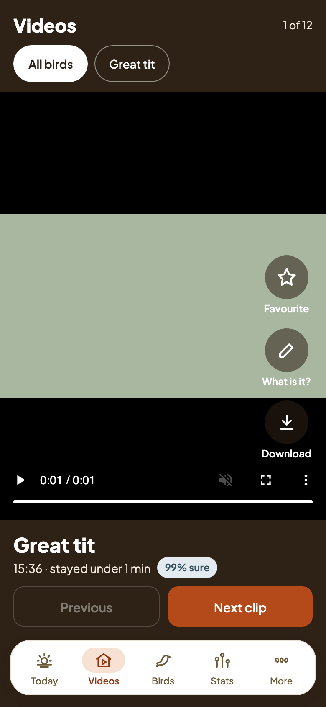
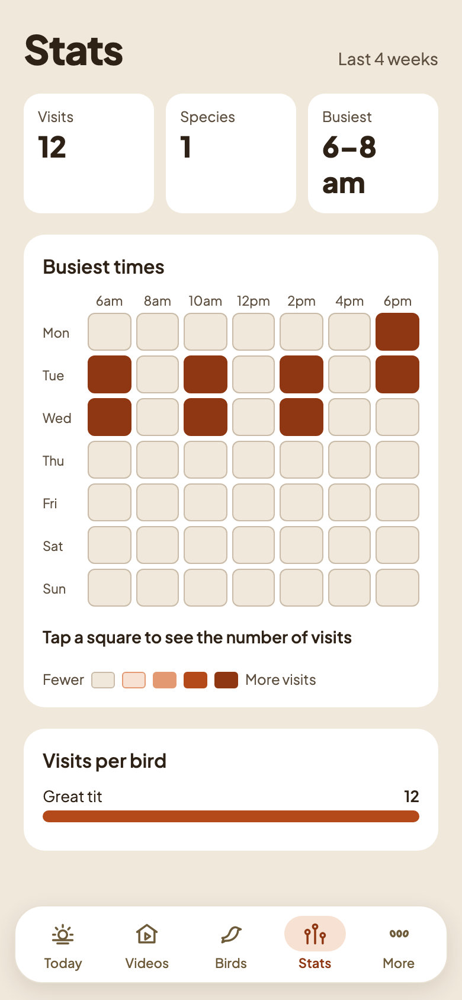

# Plan 4 results: the gallery, part 2

Tried on 3–4 November 2026 with the real app (`uv run fatball serve`, started from Terminal.app) on the owner's home Wi-Fi.

## What the owner checked

| Device | Browser | Result |
|---|---|---|
| MacBook Air | Safari / Chrome at `http://localhost:8080` | Videos works. The owner didn't like the first, dark design, so it got a light Mac layout the same day (see below). Stats and tapping a heatmap square work. |
| Google Pixel 9a | Chrome at `http://<Mac name>.local:8080` | Videos keeps the dark full-screen feed on the phone. |
| iPad | Safari | Not checked yet. |

Not confirmed by the owner yet:

- **"Download this day (.zip)".** The owner didn't find it. It is in each day heading on the list pages (Birds, Other animals, Other, Favourites), not on Today, and only in a window at least 768 px wide.
- **The Mac banner.** No banner appeared, which is expected. The camera's clips from that morning arrived more than 30 minutes after the visits ended, so they were filed without a banner, and no new bird came while the app was running. If a new bird visit gives no banner, check that notifications are allowed for Script Editor and Terminal in **System Settings → Notifications**.
- Selecting, moving and Undo, and drag-and-drop on the Mac, weren't reported on.

## What we learned

- **The Videos page needs two layouts.** On a phone, a dark full-screen feed works well. On a Mac, it left big empty dark edges and the name bar covered the video. The Mac now gets a light page: the title and the filters sit above a rounded 16:9 picture, and the name, time and buttons sit below it. The Favourite, What is it? and Download buttons stay on the picture, which the owner was happy with.
- **A sleeping camera can stay asleep.** The camera had been "Not reachable" since the afternoon before. Opening the live view in iCSee woke it, and the app reconnected within a minute.
- **Only one app can use port 8080.** An old copy of the app was still running from the day before, so the new one couldn't start ("address already in use"). Quitting the old one fixed it.

## Tests

- Python: 411 tests with `uv run pytest`, and `uv run ruff check` passes.
- Gallery: 234 Vitest tests, `svelte-check` with no errors, and 70 Playwright tests in Chromium, including axe accessibility checks and screenshot comparisons.
- CI also runs the Playwright tests in WebKit at iPad size and in Chrome at phone size. Its first run may need the screenshots refreshed.

## Left for later

- Try the iPad, the day zip, Select and Move, and drag-and-drop on the owner's devices.
- Phase 2: run the app on a Raspberry Pi, and send notifications to the phone.

## Screenshots

From demo mode (`uv run fatball demo`), with plain-colour placeholder clips, never real footage.

| Mac: Videos | Mac: Stats |
|---|---|
|  |  |

| Phone: Videos | Phone: Stats |
|---|---|
|  |  |
